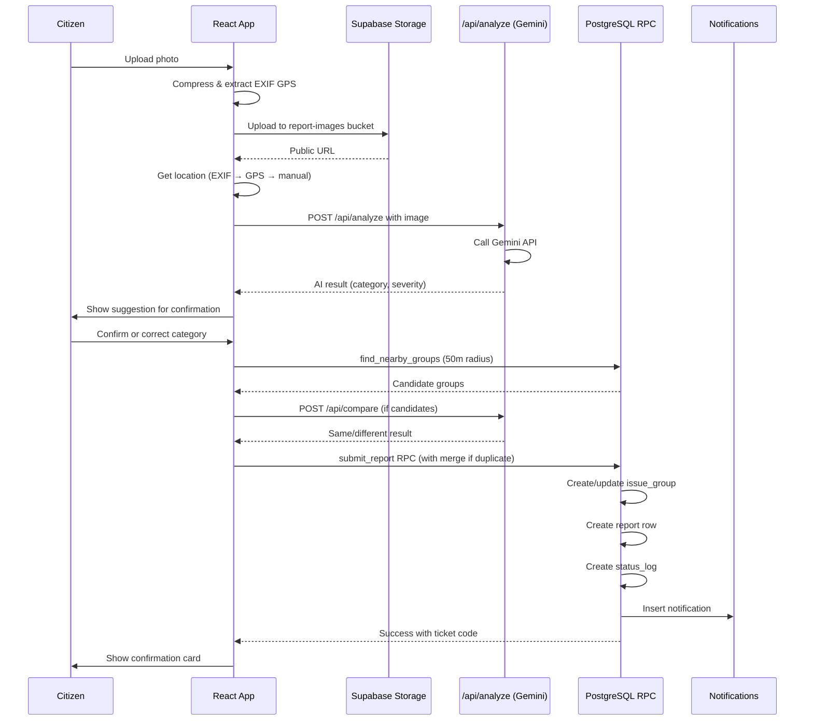

# Shikayaat - Report it. Resolve it.

A chat-based civic issue reporting web application that enables citizens to report public infrastructure problems (potholes, garbage, open drains, waterlogging, electrical hazards, streetlights, fallen trees) through a conversational AI interface. The app automatically detects issue types using computer vision, captures location data, routes reports to municipal departments, groups duplicate reports to raise priority, and provides real-time status tracking.

## Problem Statement

Reporting civic problems like potholes, open drains, and garbage to municipal authorities is slow and form-heavy. Citizens must navigate complex websites, fill lengthy forms, and often never receive confirmation that their issue was addressed. Duplicate complaints bury urgent issues, and there's no transparency about whether problems are actually fixed. This leads to citizen frustration and neglected infrastructure.

## Target Users

- **Citizens**: Residents who want to quickly report civic issues in their neighborhood
- **Municipal Staff (Admins)**: Department workers who need to triage, prioritize, and resolve reported issues

## Solution

shikayaat replaces complex forms with a simple chatbot interface. Citizens send a photo, AI suggests the issue type, the app captures location automatically, and the report is routed to the correct department. Duplicate reports are intelligently grouped to raise priority. Citizens track progress in real-time, and admins use a map dashboard to manage issues with mandatory proof of resolution.

## Key Features

### Citizen Features
- **Chat-based Reporting**: Natural conversation flow with CivicBot for reporting issues
- **AI Issue Detection**: Google Gemini vision model automatically identifies issue type and severity
- **Smart Location Capture**: EXIF GPS → browser geolocation → manual pin fallback with reverse geocoding
- **Duplicate Detection**: Two-stage system (PostGIS proximity + AI image comparison) groups similar reports
- **My Reports Dashboard**: Track all submitted issues with status timeline and resolution proof
- **Real-time Notifications**: In-app bell notifications for status updates

### Admin Features
- **Interactive Map Dashboard**: Visual overview of all issues with priority-based coloring
- **Advanced Filtering**: Filter by status, category, department, and search by ticket/address
- **Status Management**: Move issues through Submitted → Processing → Resolved workflow
- **Mandatory Proof Upload**: Resolution requires photo evidence with optional notes
- **Priority Scoring**: Automatic priority calculation based on severity, report count, and age
- **Department Routing**: Automatic assignment to appropriate municipal departments

### AI Features
- **Vision Analysis**: Classifies photos into 8 issue categories with severity assessment
- **Confidence Scoring**: Low-confidence results prompt user confirmation
- **Fallback Mechanism**: Manual category selection if AI is unavailable
- **Image Comparison**: AI-powered duplicate detection comparing visual similarity

### Engineering Features
- **Idempotent Submissions**: Double-tap protection prevents duplicate reports
- **Business Logic in Database**: Postgres RPC functions enforce rules at the data layer
- **Row-Level Security**: Fine-grained access control in Supabase
- **Server-Side API Keys**: Gemini API key never exposed to client
- **Rate Limiting**: In-memory rate limiting prevents API abuse
- **Mobile-First Design**: Optimized for 360px width and touch interactions

## Tech Stack

| Technology | Purpose | Reason |
|------------|---------|--------|
| React 19 | Frontend framework | Modern, component-based UI with hooks |
| Vite | Build tool | Fast development server and optimized production builds |
| Tailwind CSS v4 | Styling | Utility-first CSS for rapid, consistent styling |
| React Router DOM v7 | Client routing | Declarative routing with protected routes |
| Supabase Auth | Authentication | Email/password auth with JWT tokens |
| Supabase PostgreSQL + PostGIS | Database | Relational database with geospatial queries |
| Supabase Storage | File storage | Secure image uploads with RLS policies |
| Vercel Serverless Functions | Backend API | Serverless API endpoints for AI integration |
| Google Gemini API | AI vision | Image classification and comparison |
| React Leaflet + OpenStreetMap | Maps | Interactive maps without API keys |
| browser-image-compression | Image processing | Client-side compression before upload |
| exifr | EXIF data | GPS extraction from photos |

## Architecture

shikayaat follows a modern three-tier architecture with business logic pushed to the database layer for security and consistency.

```
┌─────────────────────────────────────────────────────────────────┐
│                         Client (React)                          │
│  ┌──────────┐  ┌──────────┐  ┌──────────┐  ┌──────────────────┐  │
│  │  Chat UI │  │  Reports │  │  Admin   │  │  Auth Context   │  │
│  └──────────┘  └──────────┘  └──────────┘  └──────────────────┘  │
└─────────────────────────────────────────────────────────────────┘
                            │
                            │ HTTP/HTTPS
                            │
┌─────────────────────────────────────────────────────────────────┐
│                    Vercel Serverless Functions                  │
│  ┌──────────────┐  ┌──────────────┐  ┌──────────────────────┐  │
│  │  /api/analyze│  │  /api/compare│  │  JWT Auth + Rate     │  │
│  │  (Gemini)    │  │  (Gemini)    │  │  Limit Middleware    │  │
│  └──────────────┘  └──────────────┘  └──────────────────────┘  │
└─────────────────────────────────────────────────────────────────┘
                            │
                            │ Supabase Client
                            │
┌─────────────────────────────────────────────────────────────────┐
│                        Supabase Platform                         │
│  ┌──────────────┐  ┌──────────────┐  ┌──────────────────────┐  │
│  │ PostgreSQL   │  │   Storage    │  │      Auth            │  │
│  │ + PostGIS    │  │  (RLS)       │  │   (JWT)              │  │
│  │              │  │              │  │                      │  │
│  │ RPC Functions│  │ Buckets:    │  │                      │  │
│  │ - submit_    │  │ - report-    │  │                      │  │
│  │   report     │  │   images    │  │                      │  │
│  │ - admin_     │  │ - proof-     │  │                      │  │
│  │   update_    │  │   images    │  │                      │  │
│  │   status     │  │              │  │                      │  │
│  │ - find_      │  │              │  │                      │  │
│  │   nearby_    │  │              │  │                      │  │
│  │   groups     │  │              │  │                      │  │
│  └──────────────┘  └──────────────┘  └──────────────────────┘  │
└─────────────────────────────────────────────────────────────────┘
```

### Reporting Flow Sequence



## Local Setup

### Prerequisites

- Node.js LTS (v18 or higher)
- Git
- A Supabase project (free tier works)
- A Google AI Studio API key

### Installation

1. **Clone the repository**
   ```bash
   git clone <your-repo-url>
   cd shikayaat
   ```

2. **Install dependencies**
   ```bash
   npm install
   ```

3. **Set up environment variables**
   ```bash
   cp .env.example .env
   ```
   
   Edit `.env` with your actual values:
   ```
   VITE_SUPABASE_URL=your-supabase-project-url
   VITE_SUPABASE_ANON_KEY=your-supabase-anon-key
   SUPABASE_URL=your-supabase-project-url
   SUPABASE_ANON_KEY=your-supabase-anon-key
   GEMINI_API_KEY=your-gemini-api-key
   GEMINI_MODEL=gemini-2.0-flash-exp
   ```

4. **Run the database schema**
   - Open Supabase SQL Editor
   - Copy the contents of `database/schema.sql`
   - Paste and click "Run"
   - This creates tables, RLS policies, RPC functions, and storage buckets

5. **Create an admin account**
   - Sign up a new account in the app
   - In Supabase SQL Editor, run:
     ```sql
     update public.profiles set role = 'admin' 
     where id = (select id from auth.users where email = 'your-admin-email@example.com');
     ```

6. **Start the development server**
   ```bash
   npm run dev
   ```
   This starts Vite on port 5173.

7. **Start the API server (in a separate terminal)**
   ```bash
   npm run dev:api
   ```
   This starts Vercel dev on port 3001.

   The app will be available at `http://localhost:5173`

## Environment Variables

| Variable Name | Purpose | Where Used | Example Value |
|---------------|---------|-----------|---------------|
| `VITE_SUPABASE_URL` | Supabase project URL | Client-side Supabase client | `https://xyz.supabase.co` |
| `VITE_SUPABASE_ANON_KEY` | Supabase anon public key | Client-side Supabase client | `eyJhbGciOiJIUzI1NiIsInR5cCI6IkpXVCJ9...` |
| `SUPABASE_URL` | Supabase project URL | Serverless functions | `https://xyz.supabase.co` |
| `SUPABASE_ANON_KEY` | Supabase anon public key | Serverless functions | `eyJhbGciOiJIUzI1NiIsInR5cCI6IkpXVCJ9...` |
| `GEMINI_API_KEY` | Google Gemini API key | Serverless functions only | `AIzaSy...` |
| `GEMINI_MODEL` | Gemini model name | Serverless functions only | `gemini-2.0-flash-exp` |

**Important**: Never commit `.env` file. The `GEMINI_API_KEY` is only used server-side and never exposed to the browser.

## Deployment

### Deploy to Vercel

1. **Push to GitHub**
   ```bash
   git add .
   git commit -m "Ready for deployment"
   git push origin main
   ```

2. **Deploy on Vercel**
   - Go to [vercel.com](https://vercel.com)
   - Click "Add New Project"
   - Import your GitHub repository
   - Framework preset: Vite
   - Add all 6 environment variables from your `.env` (for both Production and Preview environments)
   - Click "Deploy"

3. **Configure Supabase**
   - In Supabase Dashboard → Authentication → URL Configuration
   - Set Site URL to your Vercel URL (e.g., `https://shikayaat-xyz.vercel.app`)
   - Add the same URL to Redirect URLs

4. **Test the deployment**
   - Open `https://your-url.vercel.app/api/health` - should return `{ok:true}`
   - Test the full reporting flow
   - Verify the Gemini key is not in the browser bundle (F12 → Sources → search)

**Live URL**: {{LIVE_URL}}

**Test Accounts**:
- Admin: `admin@example.com` / `password123`
- Citizen: `citizen@example.com` / `password123`

## How Duplicate Detection Works

shikayaat uses a two-stage duplicate detection system to group reports of the same physical issue:

### Stage 1: Geospatial Proximity (PostGIS)

When a report is submitted, the app calls the `find_nearby_groups` RPC function which:
- Queries the `issue_groups` table using PostGIS `ST_DWithin`
- Finds groups within 50 meters of the new report's location
- Filters by matching category (same issue type)
- Returns up to 3 candidates ordered by distance

### Stage 2: AI Image Comparison (Gemini)

For each candidate from Stage 1:
- The app sends both images to `/api/compare`
- Gemini analyzes whether they show the **same physical issue at the same place**
- Different angles, distances, and lighting are allowed
- Different defects on the same street are **not** considered the same
- Returns: `same` (boolean), `confidence` (0-1), and `reason`

### Merging Logic

- If a candidate has `same === true` and `confidence >= 0.7`, the new report is merged
- The `report_count` increments, potentially raising the priority score
- Severity is upgraded if the new report has higher severity
- If AI comparison fails, the report is still created (no blocking)

### Priority Formula

Priority score = (report_count × 3) + severity_weight + days_open

Where severity_weight:
- Low: 1
- Medium: 3
- High: 6
- Hazard: 15

Priority buckets:
- Score < 8: Low
- Score 8-14: Medium
- Score 15-24: High
- Score ≥ 25: Critical

## Security Considerations

- **Row-Level Security (RLS)**: All database tables have RLS policies ensuring users can only access their own data
- **Server-Side API Keys**: Gemini API key is only used in Vercel serverless functions via `process.env`
- **JWT Verification**: All API endpoints verify Supabase JWT tokens before processing
- **Rate Limiting**: In-memory rate limiting prevents API abuse (6 requests/minute for analyze, 10 for compare)
- **Input Validation**: All user inputs are validated (file type, size, text length, coordinates)
- **SSRF Protection**: Image fetching only allows Supabase Storage URLs
- **Idempotent Operations**: Submissions use client request IDs to prevent duplicate reports
- **Storage Policies**: Upload paths are restricted to user ID folders (report-images) or admin-only (proof-images)
- **No Service Role**: The Supabase service_role key is never used in the application

## Known Limitations

- **Rate Limiting**: In-memory rate limiting resets on serverless function cold starts
- **GPS Accuracy**: EXIF GPS may be missing from screenshots or downloaded images
- **AI Fallbacks**: If Gemini API is down, users must manually select categories
- **Nominatim Rate Limit**: OpenStreetMap reverse geocoding has usage limits (1 request/second enforced)
- **Mobile Camera**: Desktop browsers open file picker instead of camera (use HTTPS on mobile for camera access)
- **Supabase Free Tier**: Free projects may pause after inactivity (open the app before demos)

## Future Work

- [ ] Push notifications for status updates
- [ ] Offline support with service workers
- [ ] Multi-language support
- [ ] Advanced analytics dashboard for admins
- [ ] Citizen reputation system
- [ ] Integration with municipal 311 systems
- [ ] Voice reporting support
- [ ] AR-based location pinning

## Screenshots


*Chat-based reporting with AI suggestions*


*Citizen dashboard with status tracking*


*Admin dashboard with interactive map*


*Resolution with proof photo*

## License

This project is built for educational purposes as part of a civic technology initiative.

## Acknowledgments

- Supabase for the excellent backend-as-a-service platform
- Google for the Gemini AI vision API
- OpenStreetMap contributors for map tiles
- Leaflet for the mapping library
