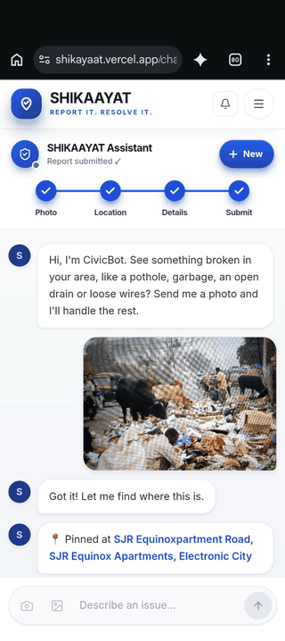
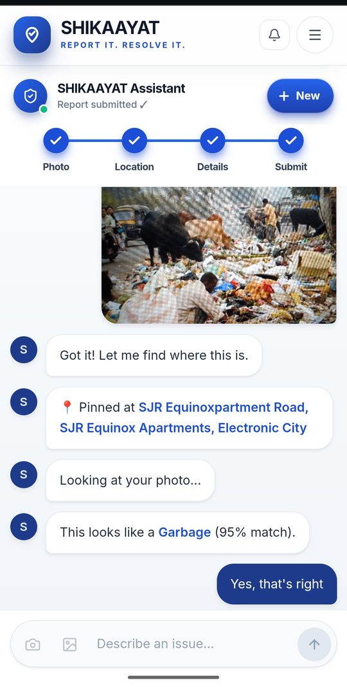
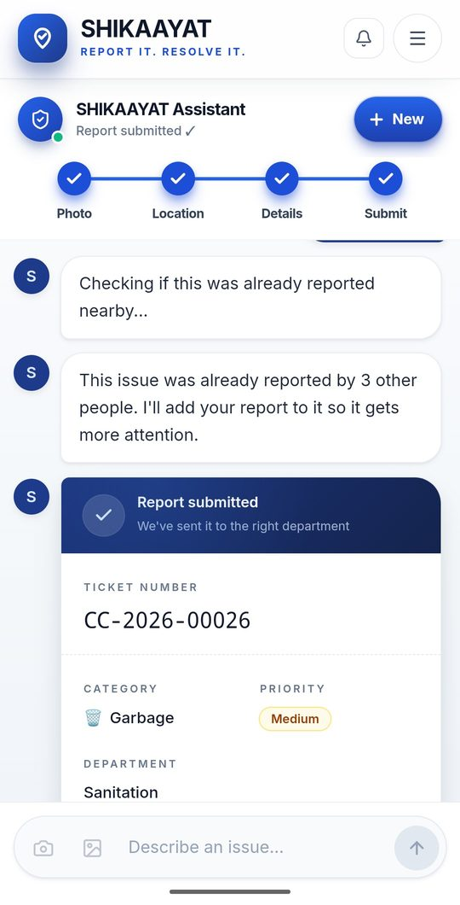
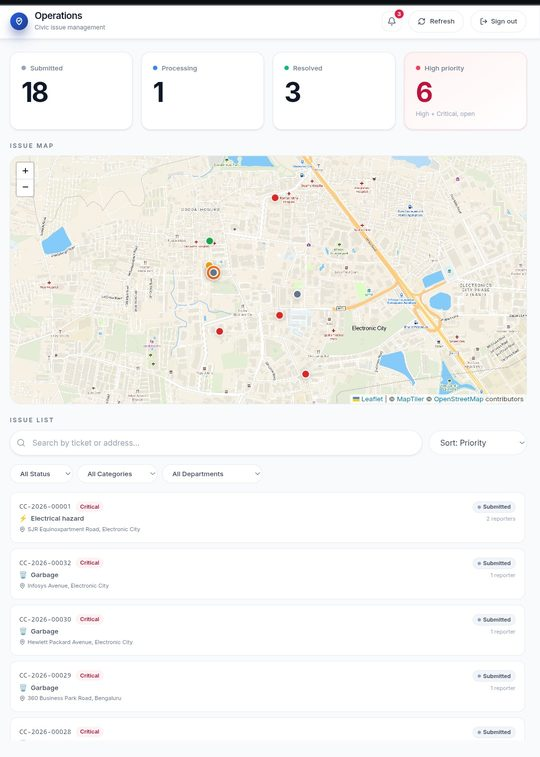
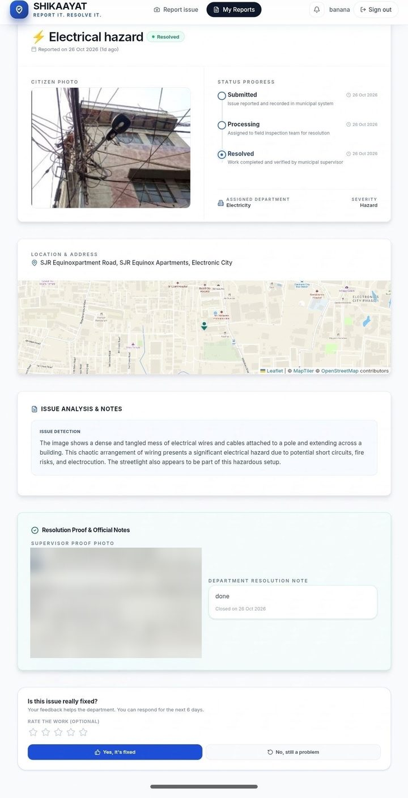
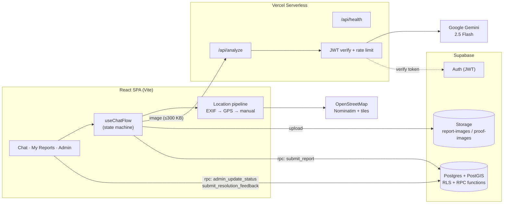
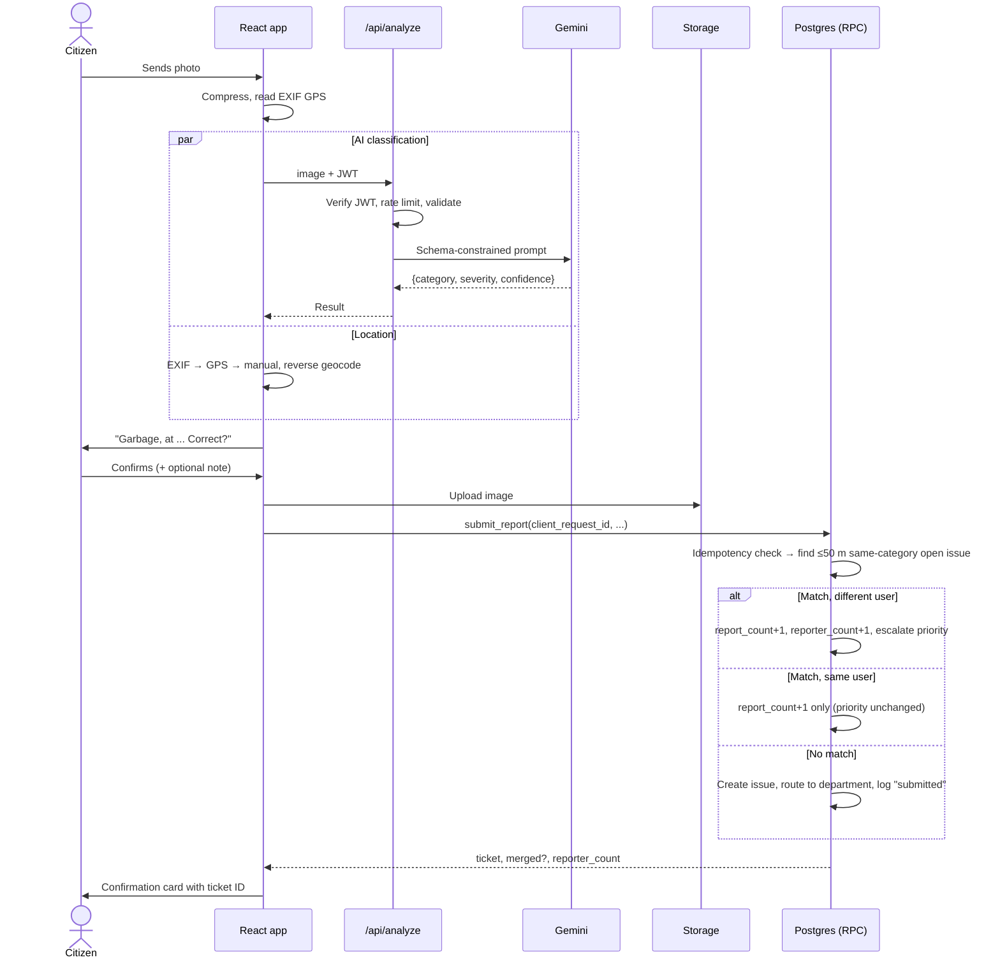
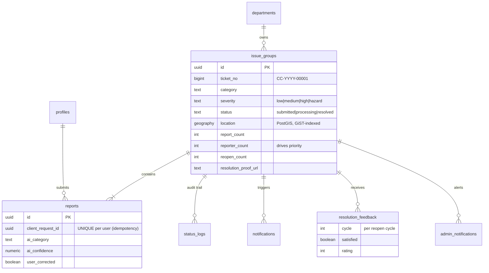

<div align="center">

# 🛡️ SHIKAAYAT

### Report it. Resolve it.

**Snap a photo of a broken street → AI names the problem → your location is captured → the right department gets a ticket → you track it until it is fixed *with proof*.**

[](https://shikayaat.vercel.app)
[](https://drive.google.com/file/d/1X9m1txIx2eyD65r9lylQLshT5jKaMucu/view?usp=sharing)
[](docs/ARCHITECTURE.md)




**Dhairya Maru** · End-Term Software Project, 2026 · Demo data: Electronic City, Bengaluru

> <b>🔑 **Demo logins (test data only):** [shikayaat.vercel.app](https://shikayaat.vercel.app)
> **Admin:** `maru2dhairya2007@gmail.com` / `dhairyaa` · **Citizen:** `banana1234@gmail.com` / `dhairyaa`</b>

</div>

---

## 📑 Table of Contents

1. [Problem Statement](#-problem-statement)
2. [Target Users](#-target-users)
3. [Solution](#-solution)
4. [Key Features & Core Workflows](#-key-features--core-workflows)
5. [Screenshots](#-screenshots)
6. [Tech Stack](#-tech-stack)
7. [Architecture](#-architecture)
8. [Engineering Highlights](#-engineering-highlights)
9. [Failure Handling](#-failure-handling-what-can-go-wrong)
10. [Security](#-security)
11. [Local Setup](#-local-setup)
12. [Environment Variables](#-environment-variables)
13. [Deployment & Evaluator Quick-Start](#-deployment--evaluator-quick-start)
14. [Project Structure](#-project-structure)
15. [Known Limitations & Roadmap](#-known-limitations--roadmap)
16. [AI Usage & Originality](#-ai-usage--originality)
17. [Submission Details](#-submission-details)

---

## 🎯 Problem Statement

Reporting a pothole, an overflowing garbage point or an open drain to a municipal body in India is a bad experience:

| Pain point | What happens today |
|---|---|
| **Form fatigue** | Long portals, department dropdowns, manual address typing. Most people give up. |
| **Wrong routing** | Citizens don't know which department owns which problem. |
| **Duplicate noise** | Ten neighbours report the same pothole as ten unrelated complaints, so nothing looks urgent. |
| **Black hole** | No confirmation, no status, and "resolved" is often just a status flip with no evidence. |

The result is neglected infrastructure and citizens who stop reporting.

## 👥 Target Users

| User | Need |
|---|---|
| **Citizens** (primary, mobile-first) | Report an issue in seconds from a phone, and know what happened to it. |
| **Municipal staff / admins** | See what is most urgent on a map, act on it, and be accountable for the fix. |

## 💡 Solution

SHIKAAYAT replaces the complaint form with a **conversation**. The citizen sends a photo to **CivicBot**; the app does the rest: it classifies the issue, finds the location, picks the owning department, merges the report with any existing ticket for the same spot, and returns a trackable ticket ID (`CC-2026-00026`). Admins get a **priority-ranked map dashboard**, and an issue can only be closed **with a proof photo**. The citizen can then **reopen it** if the fix wasn't real.

> **Why software?** The value is in the workflow glue: location resolution, de-duplication, routing, priority and accountability. A web form can't do that, and a bare LLM call can't either.

---

## ✨ Key Features & Core Workflows

### 1. Conversational reporting 💬
`Photo → compress → AI classify → locate → confirm → (optional note) → duplicate check → submit → ticket`

- Chat **state machine** with explicit stages (`PROCESSING → LOCATING → CONFIRM_LOCATION → WAIT_AI → CONFIRM_CATEGORY → AWAIT_NOTE → CHECKING_DUPLICATES → SUBMITTING`), so every step has a defined success, retry and error path.
- **Camera capture or gallery upload**, with client-side compression.
- **Text-only fallback**: no photo? Describe the issue and the same classifier handles it.
- **Low-confidence AI → user confirms** the category. If the AI is down, the user picks from category chips. The flow never dead-ends.
- Drafts survive a refresh and are **scoped to the signed-in account**, so nothing leaks between users on a shared device.

### 2. Smart location 📍
Three-tier fallback, each tried only if the previous fails:

1. **EXIF GPS** from the photo (`exifr`)
2. **Browser geolocation**
3. **Manual**: type an address or drop a pin on the map

Coordinates are reverse-geocoded to an address and ward (OpenStreetMap Nominatim), and the user **confirms or adjusts** before anything is submitted.

### 3. Duplicate merging that raises priority fairly 🧩
A report within **50 m** of an open issue of the **same category** is merged into that ticket instead of creating a new one.

- **Priority rises only when a *different* citizen reports it.** The same user re-submitting adds evidence but never inflates priority.
- CivicBot tells the user: *"This issue was already reported by 3 other people. I'll add your report to it so it gets more attention."*
- **Deterministic**: PostGIS `ST_DWithin` in SQL, no model call, so it is free, instant and auditable.

### 4. Admin triage → resolve with proof 🛠️
- **Live map** (Leaflet) with priority-coloured markers, stat cards, search by ticket/address, and filters for status, category and department.
- Status moves **forward only**: `Submitted → Processing → Resolved`.
- **Resolving requires a proof photo**, enforced in the database, not just the UI.
- Every transition is written to an audit log (`status_logs`) and **every reporter on the ticket is notified**.

### 5. Accountability loop ✅
- Citizens see a status timeline and the admin's proof photo in **My Reports**.
- If unsatisfied, they can **reopen within 7 days** (reason required, max 2 reopenings). Reopening raises priority and alerts admins.
- Satisfied citizens can leave a 1–5 rating.

**Also included:** notification bells (citizen and admin) · role-based routing · mobile-first UI with bottom navigation · animated landing page · error boundary and 404 page.

---

## 📸 Screenshots

| Chat: AI detection & location pin | Duplicate merged → ticket |
|:---:|:---:|
|  |  |

| Admin dashboard (map, stats, ranked list) | Resolved ticket: proof, note, citizen feedback |
|:---:|:---:|
|  |  |

---

## 🧰 Tech Stack

| Layer | Choice | Why |
|---|---|---|
| UI | **React 19 + Vite 7** | The chat flow is a stateful UI that suits a reducer-driven model |
| Styling | **Tailwind CSS v4** | Consistent mobile-first design |
| Routing | **React Router v7** | `ProtectedRoute` / `AdminRoute` guards for role-based pages |
| Auth | **Supabase Auth** (JWT) | The same JWT is verified by the API layer and by Postgres RLS |
| Database | **Supabase Postgres + PostGIS** | "Same spot within 50 m" is exactly `ST_DWithin` on a GiST-indexed geography |
| Storage | **Supabase Storage** | `report-images` and `proof-images` buckets with policy-controlled uploads |
| Backend | **Vercel Serverless Functions** | Keeps the Gemini key off the client; no server to maintain |
| AI | **Google Gemini 2.5 Flash** (+ Flash-Lite fallback) | Vision classification with schema-constrained JSON |
| Maps | **Leaflet + OpenStreetMap** | No paid key required (optional MapTiler style) |
| Client libs | `browser-image-compression`, `exifr`, `lucide-react` | Upload size control, GPS extraction, icons |

> Technologies were chosen because the product needs them (geospatial matching, role-based access, server-side AI), not to pad a checklist.

---

## 🏗️ Architecture

### System overview



### Reporting sequence



### Data model



### Design principle: business rules live in the database

The browser has **no direct write access** to `issue_groups`, `status_logs` or `resolution_feedback`. All mutations go through `SECURITY DEFINER` Postgres functions that re-validate the caller's identity and role. A modified client cannot skip a status, resolve without proof, or inflate priority.

> Full schema and RPC details: [`docs/ARCHITECTURE.md`](docs/ARCHITECTURE.md)

---

## ⚙️ Engineering Highlights

### 1. Transactional, idempotent submission
`submit_report` takes a client-generated `client_request_id` with `UNIQUE (user_id, client_request_id)`. A double-tap, a retry after a flaky network, or a replayed request **returns the original result instead of creating a second report**. The matched issue row is locked with `SELECT … FOR UPDATE`, so simultaneous reports can't corrupt counters.

### 2. Explainable priority score
Computed in a SQL view (`issue_groups_ranked`), so the dashboard, map and list always agree:

```
priority = reporters × 3  +  severity weight (1 / 3 / 6 / 15)  +  days open  +  reopenings × 5
```

| Bucket | Rule |
|---|---|
| 🔴 Critical | score ≥ 25, **or any `hazard` severity** (live wires always escalate) |
| 🟠 High | score ≥ 15 |
| 🟡 Medium | score ≥ 8 |
| ⚪ Low | otherwise |

Issues **age upward** automatically: a neglected ticket gets more urgent each day without anyone touching it.

### 3. An AI layer with real engineering around it
The AI is one stage in a pipeline, not the product:

| Concern | Implementation |
|---|---|
| Structured output | Gemini `responseSchema` with enums for category and severity; low temperature, capped output tokens |
| Authenticated | Every call needs a valid Supabase JWT, verified server-side |
| Abuse control | Per-user server rate limit (6 req/min) plus a client-side session cap and cooldown |
| Cost control | Images compressed to ≤300 KB; 30-minute response cache; identical in-flight requests collapsed |
| Resilience | Retry on 503; fallback model on 429; 20 s timeout; typed error codes (`ai_busy`, `ai_unavailable`) |
| Graceful degradation | If AI fails, the user picks the category manually and the report still goes through |
| Testability | `AI_MOCK=1` runs the whole app with no API key |
| Human in the loop | Low confidence → user confirms; corrections are stored (`user_corrected`) |

### 4. Deterministic de-duplication
Duplicate detection is geospatial SQL (`ST_DWithin` on a GiST index), not a model call. The AI does what only AI can (look at a picture); the database does what databases are good at.

### 5. Accountability by design
- Resolve-without-proof is **rejected by the database**.
- Status can only **move forward**.
- 7-day reopen window, mandatory reason, and a **cap of 2 reopenings**: real recourse without abuse.
- Every change is recorded in `status_logs` with actor, note and proof URL.

### 6. Resilient UX
Loading, empty, success and error states on every screen · `ErrorBoundary` · guarded routes · resumable photo-processing jobs · duplicate-submit protection in both the UI and the DB.

---

## 🛡️ Failure Handling: "What can go wrong?"

| Scenario | Behaviour |
|---|---|
| Gemini down / rate-limited / slow | Retry → fallback model → manual category picker. The report still completes. |
| Photo has no EXIF GPS | Falls back to browser geolocation, then manual address/pin |
| Location permission denied | Manual address search or map pin; the user is told why |
| Reverse geocoding fails | Falls back to a coordinate-based address; submission continues |
| Not a civic issue / unclear photo | AI flags it or returns low confidence; the user confirms or picks a category |
| Oversized / wrong-format image | Compressed client-side; the server rejects non-JPEG/PNG/WebP and >300 KB |
| Double-tap on submit / network retry | Idempotent RPC returns the original result, no second ticket |
| Same user reports same spot twice | Linked to the existing ticket; priority is **not** raised |
| Expired / missing session | `401` from the API; the route guard redirects to login |
| Citizen attempts an admin action | Blocked by route guard **and** by `is_admin()` inside the RPC |
| Admin resolves without proof / moves status backwards | Database exception, shown as a readable message |
| Reopen after 7 days, empty reason, or 3rd reopen | Rejected with an explanation |
| Admin notification insert fails | Caught, so it never blocks a citizen's report |
| Runtime render crash | `ErrorBoundary` shows a recovery screen instead of a white page |

---

## 🔐 Security

- **No secrets in the client or repo.** The Gemini key lives only in serverless env vars; `.env` is git-ignored; `.env.example` ships placeholders.
- **Row-Level Security on every table.** Citizens read only their own reports and notifications; admin data is gated by `is_admin()`.
- **Writes only via RPC.** No client `INSERT/UPDATE` policies on core tables; `SECURITY DEFINER` functions pin `search_path` and re-check `auth.uid()`.
- **Server-side role check.** Admin status lives in `profiles.role`, not in anything the client can edit.
- **Input validation at both layers.** Coordinate ranges, note ≤ 500 chars, text ≤ 300 chars, MIME and size whitelists, status whitelist.
- **Storage policies.** Only authenticated users can upload; proof photos use a separate bucket.
- **Auth-gated, rate-limited AI endpoint**, so nobody can burn the Gemini quota anonymously.

---

## 🚀 Local Setup

### Prerequisites
- Node.js **18+** and npm
- A free [Supabase](https://supabase.com) project
- A free [Google AI Studio](https://aistudio.google.com/apikey) key (optional with `AI_MOCK=1`)
- [Vercel CLI](https://vercel.com/docs/cli) (`npm i -g vercel`) to run the `/api` functions locally

### 1. Clone and install
```bash
git clone https://github.com/dhairyazyzzgit/Shikaayat-Report-Resolve.git
cd Shikaayat-Report-Resolve
npm install
```

### 2. Set up the database
In Supabase → **SQL Editor**, run [`database/schema.sql`](database/schema.sql). It creates PostGIS, tables, indexes, RLS policies, RPC functions and storage buckets, and seeds the municipal departments. The `database/migration_*.sql` scripts are idempotent upgrades for older databases.

### 3. Configure environment
```bash
cp .env.example .env
# fill in the values (see the table below)
```

### 4. Run
```bash
# Terminal 1: API functions (port 3001)
npm run dev:api

# Terminal 2: frontend
npm run dev
```
Open the URL Vite prints (usually `http://localhost:5173`).

> **No Gemini key?** Set `AI_MOCK=1` and the whole flow runs with mocked AI responses.

### 5. Create an admin
Sign up normally, then promote the account in the Supabase SQL Editor:
```sql
update public.profiles set role = 'admin'
where id = (select id from auth.users where email = 'you@example.com');
```

### 6. Production build
```bash
npm run build && npm run preview
```

---

## 🔑 Environment Variables

| Variable | Scope | Required | Description |
|---|---|:---:|---|
| `VITE_SUPABASE_URL` | Client | ✅ | Supabase project URL |
| `VITE_SUPABASE_ANON_KEY` | Client | ✅ | Supabase **anon** (public) key; safe in the browser because RLS protects data |
| `SUPABASE_URL` | Server | ✅ | Same URL, used by the API to verify JWTs |
| `SUPABASE_ANON_KEY` | Server | ✅ | Same anon key, used for `auth.getUser(token)` |
| `GEMINI_API_KEY` | Server | ✅* | Google AI key. **Never prefix with `VITE_`.** |
| `GEMINI_MODEL` | Server | – | Primary model (default `gemini-2.5-flash`) |
| `GEMINI_FALLBACK_MODEL` | Server | – | Used on rate-limit (e.g. `gemini-2.5-flash-lite`) |
| `AI_MOCK` | Server | – | `1` = deterministic mocked AI, no key needed |
| `VITE_MAPTILER_KEY` | Client | – | Optional nicer map style; falls back to OSM tiles |

\* Not required when `AI_MOCK=1`.

---

## 🌐 Deployment & Evaluator Quick-Start

| | |
|---|---|
| **Live app** | https://shikayaat.vercel.app |
| **Health check** | https://shikayaat.vercel.app/api/health |
| **Repository** | https://github.com/dhairyazyzzgit/Shikaayat-Report-Resolve |
| **Demo video** | https://drive.google.com/file/d/1X9m1txIx2eyD65r9lylQLshT5jKaMucu/view?usp=sharing |

**Hosting:** Vercel (SPA + serverless functions) · Supabase (DB, Auth, Storage). [`vercel.json`](vercel.json) configures SPA rewrites and a 30 s function timeout for AI calls.

### 🧪 Demo accounts (test data only)

| Role | Email | Password |
|---|---|---|
| Citizen | `banana1234@gmail.com` | `dhairyaa` |
| Admin | `maru2dhairya2007@gmail.com` | `dhairyaa` |

**2-minute tour:** sign in as the citizen → **Report issue** → upload a garbage or pothole photo → confirm location and category → submit and note the ticket ID → open **My Reports**. In a second browser, sign in as admin → pick the ticket on the map → **Processing** → **Resolve** with a proof photo → the citizen's bell notifies them, and they can confirm or reopen.

The demo data is centred on Electronic City, Bengaluru.

---

## 🗂️ Project Structure

```
Shikaayat-Report-Resolve/
├── api/                      # Vercel serverless functions
│   ├── analyze.js            # Auth-gated, rate-limited Gemini vision classifier
│   ├── health.js             # Liveness probe
│   └── _lib/
│       ├── auth.js           # JWT verification + per-user rate limiter
│       └── gemini.js         # Model calls: cache, retry, fallback, mock mode
├── database/
│   ├── schema.sql            # Full setup: tables, RLS, RPCs, storage, seed data
│   └── migration_*.sql       # Idempotent incremental upgrades
├── src/
│   ├── pages/                # Landing, Login, Signup, Chat, MyReports, ReportDetail, AdminDashboard
│   ├── hooks/                # useChatFlow (state machine), useNotifications
│   ├── components/
│   │   ├── chat/             # Message, card, map and camera components
│   │   ├── admin/            # Map, list, stat cards, detail panel, resolve modal
│   │   └── common/           # Route guards, ErrorBoundary, navbars, lightbox
│   ├── lib/                  # location, geocode, photo jobs, AI guard, formatting
│   └── context/AuthContext.jsx
├── docs/
│   ├── ARCHITECTURE.md
│   └── screenshots/
├── vercel.json
└── .env.example
```

---

## 🔭 Known Limitations & Roadmap

| Limitation | Why / mitigation | Next step |
|---|---|---|
| Server rate limiter is **in-memory** (per serverless instance) | Fine for a single-region MVP; a client-side guard adds a second layer | Redis / Upstash |
| Notifications use **polling** while the tab is visible | Simple and reliable, no socket infrastructure | Supabase Realtime or web push |
| Image buckets are **publicly readable** | Civic evidence with unguessable URLs | Signed URLs for sensitive categories |
| 50 m duplicate radius is fixed | Reasonable for point issues like potholes | Per-category radii |
| Public Nominatim for reverse geocoding | Free and keyless | Cache or use a paid geocoder at scale |
| Single city, seeded department list | Keeps the demo focused | Multi-city tenancy, ward-boundary routing |

**Roadmap:** ward polygon auto-routing · email/WhatsApp status updates · public transparency map · SLA timers with auto-escalation · Hindi and regional-language chat · PWA with offline draft queue.

---

## 🤖 AI Usage & Originality

- **In the product:** Gemini does vision classification only. Duplicate detection, routing, priority and authorization are deterministic SQL and application logic.
- **In development:** AI coding assistants were used for some code and debugging help, as the guidelines allow. Design decisions, testing and deployment are my own.
- **Originality:** Built from scratch; not a tutorial clone or a fork. Map data © OpenStreetMap contributors.

---

## 📋 Submission Details

| Field | Value |
|---|---|
| **Project Name** | SHIKAAYAT: Report it. Resolve it. |
| **Student Name** | Dhairya Maru |
| **Problem Statement** | Citizens struggle to report civic issues; duplicates bury urgent ones; and "resolved" has no proof. |
| **GitHub Repository** | https://github.com/dhairyazyzzgit/Shikaayat-Report-Resolve |
| **Deployed Application** | https://shikayaat.vercel.app |
| **Demo Video** | https://drive.google.com/file/d/1X9m1txIx2eyD65r9lylQLshT5jKaMucu/view?usp=sharing |
| **Tech Stack** | React 19, Vite, Tailwind v4, Supabase (Auth, Postgres + PostGIS, Storage), Vercel Serverless, Google Gemini, Leaflet |
| **Major Features** | Chat-based reporting · AI issue detection · 3-tier location capture · geospatial duplicate merging with fair priority · admin map dashboard · proof-required resolution · citizen reopen and rating loop · notifications |

---

<div align="center">

**Built so that reporting a broken street takes less time than ignoring it.** 🌆

</div>
