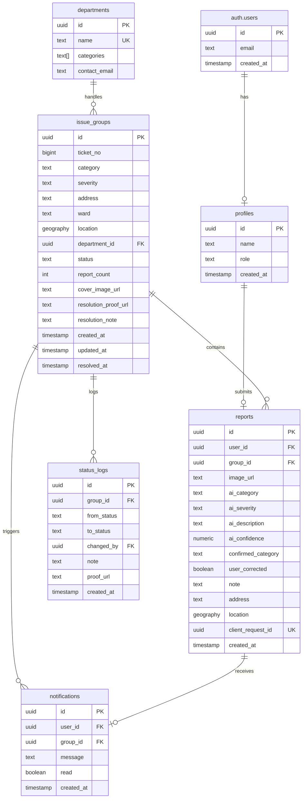

# shikayaat Architecture Documentation

This document describes the technical architecture, data models, and key algorithms of shikayaat.

## System Overview

shikayaat is a full-stack web application built with React on the frontend and Supabase (PostgreSQL + PostGIS + Storage) on the backend. AI processing is handled by Vercel serverless functions that call the Google Gemini API.

### Technology Stack

- **Frontend**: React 19, Vite, Tailwind CSS v4, React Router DOM v7
- **Backend**: Vercel Serverless Functions (Node.js ESM)
- **Database**: Supabase PostgreSQL with PostGIS extension
- **Storage**: Supabase Storage with Row-Level Security
- **Authentication**: Supabase Auth (JWT-based)
- **AI/ML**: Google Gemini 2.0 Flash (vision model)
- **Maps**: React Leaflet + OpenStreetMap

### Architecture Pattern

The application follows a three-tier architecture with business logic pushed to the database layer:

1. **Presentation Layer**: React SPA with client-side routing
2. **Application Layer**: Vercel serverless functions for AI processing
3. **Data Layer**: Supabase PostgreSQL with RLS and RPC functions

## Entity Relationship Diagram



## Database Schema Details

### Tables

#### `departments`
Stores municipal departments and the issue categories they handle.
- **id**: UUID primary key
- **name**: Unique department name (e.g., "Roads & Infrastructure")
- **categories**: Array of category strings (e.g., `['pothole']`)
- **contact_email**: Optional contact email

#### `profiles`
User profile data linked to Supabase Auth.
- **id**: UUID primary key (references `auth.users`)
- **name**: Display name
- **role**: Either 'citizen' or 'admin'
- **created_at**: Timestamp

#### `issue_groups`
Groups duplicate reports of the same physical issue.
- **id**: UUID primary key
- **ticket_no**: Auto-incrementing serial number
- **category**: Issue category (enum: pothole, garbage, open_drain, waterlogging, electrical_hazard, streetlight, fallen_tree, other)
- **severity**: Severity level (enum: low, medium, high, hazard)
- **address**: Human-readable address
- **ward**: Administrative ward
- **location**: PostGIS geography point (EPSG:4326)
- **department_id**: Foreign key to departments
- **status**: Current status (enum: submitted, processing, resolved)
- **report_count**: Number of reports in this group
- **cover_image_url**: URL of representative image
- **resolution_proof_url**: URL of admin's proof photo
- **resolution_note**: Admin's resolution notes
- **created_at**: Group creation timestamp
- **updated_at**: Last update timestamp
- **resolved_at**: Resolution timestamp (null if not resolved)

**Indexes**:
- GIST index on `location` for spatial queries
- B-tree index on `status` for filtering

#### `reports`
Individual citizen reports.
- **id**: UUID primary key
- **user_id**: Foreign key to auth.users
- **group_id**: Foreign key to issue_groups
- **image_url**: URL of uploaded photo
- **ai_category**: AI-suggested category
- **ai_severity**: AI-suggested severity
- **ai_description**: AI-generated description
- **ai_confidence**: AI confidence score (0-1)
- **confirmed_category**: User-confirmed category
- **user_corrected**: Whether user corrected AI suggestion
- **note**: Optional citizen note
- **address**: Address at time of report
- **location**: PostGIS geography point
- **client_request_id**: UUID for idempotency (unique per user)
- **created_at**: Report timestamp

**Indexes**:
- B-tree index on `user_id` for user's reports
- B-tree index on `group_id` for group's reports
- Unique constraint on `(user_id, client_request_id)` for idempotency

#### `status_logs`
Audit trail of status changes.
- **id**: UUID primary key
- **group_id**: Foreign key to issue_groups
- **from_status**: Previous status
- **to_status**: New status
- **changed_by**: Foreign key to auth.users (admin)
- **note**: Optional note
- **proof_url**: URL of proof photo (for resolution)
- **created_at**: Timestamp

#### `notifications`
User notifications for status updates.
- **id**: UUID primary key
- **user_id**: Foreign key to auth.users
- **group_id**: Foreign key to issue_groups
- **message**: Notification message
- **read**: Read status (boolean)
- **created_at**: Timestamp

**Indexes**:
- Composite index on `(user_id, read)` for unread queries

### Views

#### `issue_groups_ranked`
Computed view that adds derived columns to issue_groups:
- **ticket_code**: Human-readable ticket (e.g., "CC-2026-00001")
- **department_name**: Joined from departments table
- **lat, lng**: Extracted from geography point
- **days_open**: Days since creation (or until resolution)
- **priority_score**: Computed priority score (see formula below)

**Security**: Uses `security_invoker = true` to respect RLS policies.

### Storage Buckets

#### `report-images`
Public bucket for citizen-uploaded photos.
- **Path pattern**: `{user_id}/{uuid}.jpg`
- **RLS Policy**: Users can only upload to their own folder
- **Public read**: Yes

#### `proof-images`
Public bucket for admin resolution proof photos.
- **Path pattern**: `{group_id}/{uuid}.jpg`
- **RLS Policy**: Only admins can upload
- **Public read**: Yes

## Database Functions (RPC)

### `submit_report`

Creates a new report, either as a new issue group or merged into an existing one.

**Parameters**:
- `p_client_request_id`: UUID for idempotency
- `p_image_url`: URL of uploaded photo
- `p_lat, p_lng`: Coordinates
- `p_address, p_ward`: Location details
- `p_category`: Confirmed issue category
- `p_severity`: Severity level
- `p_ai_category, p_ai_severity, p_ai_description, p_ai_confidence`: AI analysis results
- `p_user_corrected`: Whether user corrected AI
- `p_note`: Optional citizen note
- `p_merge_group_id`: Optional group ID to merge into

**Returns**: JSONB with `report_id`, `group_id`, `merged`, `report_count`, `duplicate_submission`

**Logic**:
1. Check authentication and validate inputs
2. Check for duplicate submission (same client_request_id)
3. If merge_group_id provided, verify it's within 75m and same category
4. If merging: increment report_count, upgrade severity if higher
5. If new group: route to appropriate department, create group and status_log
6. Create report row
7. Return result

**Idempotency**: Same client_request_id returns existing report without creating duplicates.

### `admin_update_status`

Updates issue status with forward-only progression and mandatory proof for resolution.

**Parameters**:
- `p_group_id`: Issue group UUID
- `p_new_status`: New status (submitted → processing → resolved)
- `p_note`: Optional admin note
- `p_proof_url`: Required proof photo URL for resolution

**Returns**: void

**Logic**:
1. Verify caller is admin
2. Validate status is in allowed set
3. Check status can only move forward (submitted → processing → resolved)
4. Require proof_url if status is 'resolved'
5. Update issue_groups with new status, timestamps, and resolution data
6. Create status_log entry
7. Create notifications for all reporters

### `find_nearby_groups`

Finds existing issue groups near a location for duplicate detection.

**Parameters**:
- `p_lat, p_lng`: Coordinates
- `p_category`: Issue category
- `p_radius_m`: Search radius (default 50m)

**Returns**: Table with `id`, `cover_image_url`, `report_count`, `status`, `distance_m`

**Logic**:
1. Use PostGIS `ST_DWithin` to find groups within radius
2. Filter by category and non-resolved status
3. Order by distance, return top 3

### Helper Functions

#### `is_admin()`
Returns true if current user has admin role.

#### `sev_rank(s)`
Maps severity to numeric rank for comparison (low=1, medium=2, high=3, hazard=4).

#### `handle_new_user()`
Trigger that creates profile row when user signs up.

## Row-Level Security Policies

### Read Policies

- **departments**: All authenticated users can read
- **profiles**: Users can read their own profile; admins can read all
- **issue_groups**: All authenticated users can read
- **reports**: Users can read their own reports; admins can read all
- **status_logs**: Admins can read all; users can read logs for their own reports
- **notifications**: Users can read their own notifications

### Write Policies

- **No direct INSERT/UPDATE on issue_groups, reports, status_logs**: All writes go through RPC functions
- **Storage report-images**: Users can only upload to their own folder (`{user_id}/...`)
- **Storage proof-images**: Only admins can upload

This ensures business rules are enforced at the database layer, even if the client is compromised.

## Priority Scoring Algorithm

### Formula

```
priority_score = (report_count × 3) + severity_weight + days_open
```

Where:
- `report_count`: Number of reports in the group
- `severity_weight`: low=1, medium=3, high=6, hazard=15
- `days_open`: Days since creation (or until resolution)

### Priority Buckets

- **Low**: score < 8
- **Medium**: score 8-14
- **High**: score 15-24
- **Critical**: score ≥ 25

### Rationale

- **Report count multiplier (3)**: Encourages duplicate reporting to surface widespread issues
- **Severity weights**: Hazard issues get highest priority (15), then high (6), medium (3), low (1)
- **Days open**: Older issues get higher priority (aging)

Example calculations:
- Single low-severity pothole, 1 day old: 1×3 + 1 + 1 = **5 (Low)**
- 3 reports of medium-severity garbage, 5 days old: 3×3 + 3 + 5 = **17 (High)**
- Hazard electrical issue, 1 report, 2 days old: 1×3 + 15 + 2 = **20 (High)**
- 5 reports of high-severity pothole, 10 days old: 5×3 + 6 + 10 = **31 (Critical)**

## Duplicate Detection Algorithm

### Two-Stage Process

#### Stage 1: Geospatial Proximity (PostGIS)

1. When user submits a report, call `find_nearby_groups(lat, lng, category, 50m)`
2. PostGIS uses `ST_DWithin` with geography type for accurate distance calculation
3. Returns up to 3 candidate groups within 50m of the same category
4. If no candidates, proceed to create new group

#### Stage 2: AI Image Comparison (Gemini)

For each candidate from Stage 1:

1. Send both images to `/api/compare` endpoint
2. Gemini receives prompt: "Determine whether both images show the exact SAME physical issue at the SAME place. Different camera angles, distances, or lighting conditions are allowed. However, two different defects on the same street are NOT the same issue."
3. Gemini returns: `same` (boolean), `confidence` (0-1), `reason` (string)
4. If `same === true` and `confidence >= 0.7`, merge into this group
5. Stop at first match (no need to check remaining candidates)

### Merging Logic

If a duplicate is found:
- Set `p_merge_group_id` when calling `submit_report`
- RPC function verifies group is within 75m and same category
- Increment `report_count`
- Upgrade severity if new report has higher severity
- Create new report row linked to existing group
- Return `merged: true` to show user

If no duplicate or AI fails:
- Create new issue group
- Route to appropriate department based on category
- Return `merged: false`

### Fallback Behavior

If AI comparison fails (API error, timeout, etc.):
- Log warning to console
- Treat as "no duplicate"
- Create new group
- Report is never blocked by AI downtime

### Why Two Stages?

1. **PostGIS first**: Fast, reliable, no API costs, handles obvious duplicates
2. **AI second**: Handles edge cases where proximity isn't enough (e.g., two potholes on same street)
3. **Confidence threshold**: 0.7 reduces false positives
4. **Non-blocking**: If AI fails, report still succeeds

## API Endpoints

### `/api/health`

**Method**: GET
**Auth**: None
**Response**: `{ ok: true }`
**Purpose**: Health check for deployment verification

### `/api/analyze`

**Method**: POST
**Auth**: Required (JWT)
**Rate Limit**: 6 requests/minute per user
**Body**:
```json
{
  "imageBase64": "base64-encoded-image",
  "mimeType": "image/jpeg",
  "userText": "optional description"
}
```
**Response**:
```json
{
  "is_civic_issue": true,
  "category": "pothole",
  "severity": "high",
  "confidence": 0.92,
  "description": "Large pothole on asphalt road"
}
```
**Purpose**: AI analysis of uploaded photo

**Validation**:
- Image must be JPEG, PNG, or WebP
- Image size ≤ 300 KB (after base64 decode)
- User text ≤ 300 characters
- Either image or text required

**Error Codes**:
- `unauthorized`: Missing or invalid token
- `invalid_request`: Invalid input
- `ai_busy`: Rate limit exceeded
- `ai_unavailable`: Gemini API error

### `/api/compare`

**Method**: POST
**Auth**: Required (JWT)
**Rate Limit**: 10 requests/minute per user
**Body**:
```json
{
  "newImageBase64": "base64-encoded-new-image",
  "mimeType": "image/jpeg",
  "candidateImageUrl": "https://supabase.co/...",
  "category": "pothole"
}
```
**Response**:
```json
{
  "same": true,
  "confidence": 0.85,
  "reason": "Same pothole, different angle"
}
```
**Purpose**: AI comparison for duplicate detection

**Validation**:
- Both images must be valid
- candidateImageUrl must be from Supabase Storage (SSRF protection)
- Category required

**SSRF Protection**:
- Only allows URLs from `process.env.SUPABASE_URL`
- Path must start with `/storage/v1/object/public/`

## Security Architecture

### Authentication Flow

1. User signs up/logs in via Supabase Auth
2. Supabase returns JWT access token
3. Token stored in memory (not localStorage for security)
4. Token sent in `Authorization: Bearer <token>` header for API calls
5. Serverless functions verify token with Supabase

### Authorization Layers

1. **Client-side**: React Router protected routes (ProtectedRoute, AdminRoute)
2. **API layer**: `requireUser()` middleware verifies JWT
3. **Database layer**: RLS policies enforce row-level access
4. **RPC layer**: Functions check `is_admin()` for admin operations

### API Key Protection

- **Gemini API key**: Only in `process.env.GEMINI_API_KEY` on server
- **Never exposed**: Not in client code, not in bundle
- **Verification**: Search production bundle for key to confirm

### Input Validation

All inputs are validated at multiple layers:

1. **Client-side**: File type, size, text length
2. **API layer**: Type checking, size limits, format validation
3. **Database layer**: CHECK constraints, NOT NULL constraints

### Rate Limiting

In-memory rate limiting per user:
- `/api/analyze`: 6 requests/minute
- `/api/compare`: 10 requests/minute

Resets on serverless cold start (acceptable for this use case).

### Idempotency

Submissions use `client_request_id` (UUID) to prevent duplicates:
- Same UUID + same user = same report
- Double-tap protection
- Network retry safety

## Open Source Libraries Used

### Frontend
- **React 19**: UI framework
- **Vite 7**: Build tool and dev server
- **Tailwind CSS v4**: Styling
- **React Router DOM v7**: Client routing
- **React Leaflet v5**: Map components
- **Leaflet v1.9**: Map library
- **Lucide React**: Icon library
- **Supabase JS Client v2**: Database and auth client
- **browser-image-compression v2**: Image compression
- **exifr v7**: EXIF GPS extraction

### Backend
- **@supabase/supabase-js**: Supabase client for serverless functions
- **Node.js crypto**: UUID generation and hashing

### Services
- **Supabase**: Backend-as-a-Service (Auth, PostgreSQL, Storage)
- **Google Gemini API**: AI vision model
- **OpenStreetMap**: Free map tiles (via Nominatim for geocoding)

## Performance Considerations

### Database
- **Spatial indexes**: GIST index on location for fast proximity queries
- **Composite indexes**: (user_id, read) for notification queries
- **View materialization**: issue_groups_ranked is a live view (computed on query)
- **Connection pooling**: Handled by Supabase

### API
- **Request deduplication**: In-memory Map prevents duplicate Gemini calls for same request
- **AbortController**: 20s timeout for Gemini calls
- **Retry logic**: Single retry on 429/503 errors
- **Response caching**: Geocoding results cached in sessionStorage

### Client
- **Image compression**: Client-side compression before upload reduces bandwidth
- **Lazy loading**: Images use `loading="lazy"`
- **Code splitting**: Vite automatic code splitting by route
- **Object URL cleanup**: Revoke object URLs to prevent memory leaks

## Monitoring and Observability

### Current State
- Console.error logging for errors
- Supabase dashboard for database metrics
- Vercel dashboard for function metrics

### Recommended Additions
- Structured logging (e.g., pino)
- Error tracking (e.g., Sentry)
- Performance monitoring (e.g., Vercel Analytics)
- Database query logging (Supabase logs)

## Deployment Architecture

### Vercel Deployment

```
┌─────────────────────────────────────────┐
│           Vercel Edge Network           │
└─────────────────────────────────────────┘
                    │
        ┌───────────┴───────────┐
        │                       │
┌───────▼────────┐    ┌────────▼────────┐
│  Static Assets │    │ Serverless API  │
│  (React build) │    │  Functions      │
└────────────────┘    └─────────────────┘
        │                       │
        │                       │
┌───────▼──────────────────────▼────────┐
│           Supabase Platform            │
│  ┌─────────┐  ┌─────────┐  ┌────────┐ │
│  │  Auth   │  │   DB    │  │Storage │ │
│  └─────────┘  └─────────┘  └────────┘ │
└────────────────────────────────────────┘
```

### Environment Variables

Production variables set in Vercel dashboard:
- `VITE_SUPABASE_URL` (client)
- `VITE_SUPABASE_ANON_KEY` (client)
- `SUPABASE_URL` (server)
- `SUPABASE_ANON_KEY` (server)
- `GEMINI_API_KEY` (server only)
- `GEMINI_MODEL` (server only)

### Function Configuration

`vercel.json` configures:
- `maxDuration: 30` seconds for API functions (for Gemini timeout)
- Rewrites for client-side routing
- CORS headers for API endpoints

## Disaster Recovery

### Database Backups
- Supabase provides automated daily backups
- Point-in-time recovery available (7 days on free tier)

### Data Loss Scenarios
- **Supabase outage**: App becomes read-only (can't submit reports)
- **Gemini outage**: Manual category selection fallback
- **Storage outage**: Can't upload photos (app blocks with error)

### Recovery Procedures
1. Restore from Supabase backup if needed
2. Redeploy from GitHub if Vercel has issues
3. Update environment variables if keys rotate
